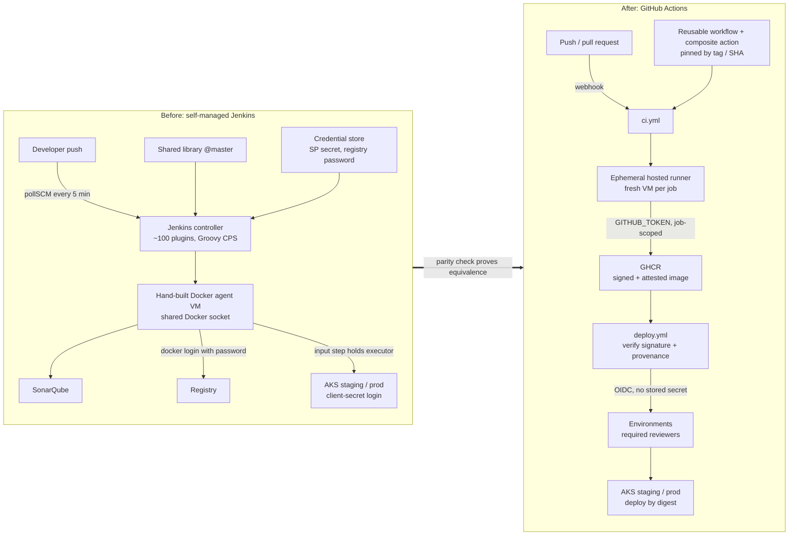
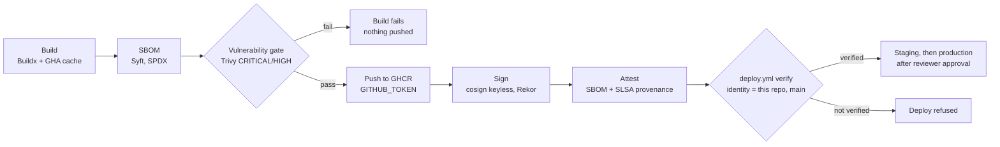
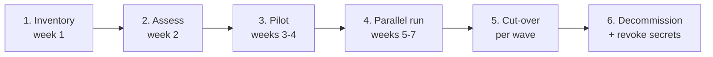

# Jenkins to GitHub Actions migration: reference implementation

[](https://github.com/rsk071216-stack/jenkins-to-github-actions-migration/actions/workflows/ci.yml)


A complete, working example of moving a real-world Jenkins pipeline to GitHub Actions **and
proving the new pipeline does the same job**. It contains the "before" (an annotated
declarative Jenkinsfile with a shared library), the "after" (hardened GitHub Actions
workflows with a secure supply chain), an automated **parity check** that compares both on
every commit, and the playbook I use to run the migration for a whole engineering
organisation.

> Built by **Raees Khan**, Cloud DevOps engineer. 9+ years running Jenkins, Maven, SonarQube
> and Nexus at enterprise scale (TCS, Cognizant), and since then GitHub Actions, ACR/ECR and
> AKS. I help teams leave Jenkins without breaking delivery.

---

## The problem this solves

If you manage an engineering team that still runs on Jenkins, the cost is mostly invisible
until something breaks:

- **Maintenance tax.** A controller, its JVM, a fleet of hand-built agents and 100+ plugins
  that must be upgraded in lock-step. Platform engineers spend days per month keeping the
  lights on instead of improving delivery.
- **Stored credentials.** Cloud service principal secrets and registry passwords live in the
  Jenkins credential store, are shared across jobs, rotated by hand (if at all), and one careless `set -x` away from
  appearing in a build log.
- **Plugin CVEs.** Jenkins plugins are a recurring source of critical advisories. Patching
  one often forces upgrading others, which means change freezes and broken pipelines.
- **Slow feedback.** SCM polling, fixed agent pools with queueing at peak times, no shared
  build cache, and `input` steps that hold executors while waiting for a human.
- **No supply-chain evidence.** Nothing proves that the image running in production was
  built from reviewed code by the trusted pipeline.

The hard part of a migration is not writing YAML. It is **inventory, sequencing, keeping
delivery running during the change, and proving equivalence** so that teams and auditors
trust the new system. This repository shows all of it on one service.

## Before and after



### One stage, side by side

<table>
<tr><th>Jenkins (legacy/Jenkinsfile)</th><th>GitHub Actions (reusable-container-build.yml)</th></tr>
<tr>
<td>

```groovy
stage('Push') {
  when { branch 'main' }
  agent { label 'docker' }
  steps {
    withCredentials([usernamePassword(
        credentialsId: 'acr-push',
        usernameVariable: 'REG_USER',
        passwordVariable: 'REG_PASS')]) {
      sh 'echo "$REG_PASS" | docker login \
            "$REGISTRY" -u "$REG_USER" \
            --password-stdin'
      sh 'docker push "${IMAGE}:${IMAGE_TAG}"'
    }
    // No SBOM, no signature, no provenance
  }
}
```

</td>
<td>

```yaml
# caller job runs only on main and grants:
# packages/id-token/attestations: write
- uses: docker/login-action@<sha> # v4.6.0
  with:
    registry: ghcr.io
    username: ${{ github.actor }}
    password: ${{ secrets.GITHUB_TOKEN }} # job-scoped
- id: push
  uses: docker/build-push-action@<sha> # v7.4.0
  with:
    push: true
    tags: ${{ steps.meta.outputs.tags }}
    cache-from: type=gha,scope=container-build
- run: cosign sign --yes "$IMAGE@$DIGEST"   # keyless
- uses: actions/attest-build-provenance@<sha>
  with:
    subject-name: ${{ steps.vars.outputs.image }}
    subject-digest: ${{ steps.push.outputs.digest }}
```

</td>
</tr>
</table>

The full stage-by-stage mapping (agent, stash, credentials, shared library, input, parallel,
when, post, triggers and more) is in [docs/concept-mapping.md](docs/concept-mapping.md).

## Secure supply chain



## Features

| Area | What is implemented | Where |
| --- | --- | --- |
| Legacy baseline | Declarative Jenkinsfile (checkout, build, test, SonarQube, quality gate, Docker build, Trivy, push, deploy staging, approval, deploy prod), shared library steps, plugin list, every problem annotated | [`legacy/`](legacy/) |
| CI | Biome lint/format, hadolint, actionlint + shellcheck, Node 22/24 test matrix with coverage thresholds, JUnit + LCOV reports | [`ci.yml`](.github/workflows/ci.yml) |
| Reuse | Composite action (replaces `vars/nodeBuild.groovy`), reusable workflow (replaces `vars/dockerBuildPush.groovy`) callable from any repo | [`.github/actions/node-test`](.github/actions/node-test/action.yml), [`reusable-container-build.yml`](.github/workflows/reusable-container-build.yml) |
| Supply chain | SBOM, Trivy gate + SARIF, GHCR via `GITHUB_TOKEN`, cosign keyless signature, cosign SBOM attestation, SLSA build provenance | reusable workflow |
| Parity check | Replays the Jenkinsfile's own test and Docker commands and compares tests, runtime config, filesystem content and SBOM with the GitHub Actions path | `parity` job, [`scripts/parity/`](scripts/parity/) |
| Legacy validation | Groovy compile check of Jenkinsfile + shared library, structural assertions | `legacy-validate` job, [`scripts/legacy/`](scripts/legacy/) |
| Deployment | OIDC to Azure, environments with required reviewers, signature + provenance verification gate, deploy by digest, automatic rollback | [`deploy.yml`](.github/workflows/deploy.yml) |
| Hardening | Least-privilege `permissions`, write scopes only on main, every action pinned by commit SHA, `persist-credentials: false`, timeouts, concurrency, distroless non-root image | all workflows |
| Maintenance | Dependabot for actions, Docker base digest and npm, with cooldowns | [`dependabot.yml`](.github/dependabot.yml) |
| Playbook | Phases, RACI, risk register, rollback plan, success metrics, inventory template, GitHub Actions Importer usage | [`docs/`](docs/) |

## What makes this different

- **Equivalence is proven, not claimed.** The `parity` job extracts the agent image and the
  `sh` commands directly from `legacy/Jenkinsfile`, runs them, and fails the build if the
  GitHub Actions path produces different tests, a different runtime config, different file
  contents or a different package list. This is the evidence an engineering manager needs
  before switching off Jenkins.
- **Migration of the operating model, not just the syntax.** `input` becomes environment
  reviewers, stored secrets become OIDC, the shared library becomes versioned reusable
  workflows, plugin upgrades become SHA-pinned actions with Dependabot.
- **Security by default.** Pull requests get a read-only token. Only `main` can push, sign and
  attest. Deployments refuse images that were not built and signed by this repository's
  workflows on `main`.
- **Honest scope.** What CI verifies and what it does not is listed below.

## Verify the published image yourself

Every push to `main` publishes `ghcr.io/rsk071216-stack/jenkins-to-github-actions-migration`
(tags: `latest`, `main`, `sha-<commit>`). The digest of each build is printed in the run
summary of the `image (publish, sign, attest)` job.

```bash
IMAGE=ghcr.io/rsk071216-stack/jenkins-to-github-actions-migration
DIGEST=$(crane digest "$IMAGE:latest")   # or: docker buildx imagetools inspect "$IMAGE:latest"

# 1. Keyless signature: must be issued to a workflow of this repository, on main
cosign verify "$IMAGE@$DIGEST" \
  --certificate-identity-regexp '^https://github.com/rsk071216-stack/jenkins-to-github-actions-migration/.github/workflows/.+@refs/heads/main$' \
  --certificate-oidc-issuer https://token.actions.githubusercontent.com

# 2. SLSA build provenance (GitHub artifact attestations)
gh attestation verify "oci://$IMAGE@$DIGEST" --repo rsk071216-stack/jenkins-to-github-actions-migration

# 3. SBOM attestation (SPDX), signed by the same identity
cosign verify-attestation "$IMAGE@$DIGEST" --type spdxjson \
  --certificate-identity-regexp '^https://github.com/rsk071216-stack/jenkins-to-github-actions-migration/.github/workflows/.+@refs/heads/main$' \
  --certificate-oidc-issuer https://token.actions.githubusercontent.com \
  | jq -r '.payload' | base64 -d | jq '.predicate.packages | length'
```

## Repository layout

```text
.
├── app/                              # versioning-service: Node.js 22, zero dependencies
│   ├── src/                          # app.js (routes), semver.js (logic), server.js, healthcheck.js
│   ├── test/                         # node:test suites (coverage gates in package.json)
│   └── Dockerfile                    # distroless, pinned by digest, non-root
├── legacy/                           # BEFORE: Jenkinsfile, shared library, plugins.txt
├── .github/
│   ├── workflows/
│   │   ├── ci.yml                    # AFTER: lint, test, legacy-validate, parity, image
│   │   ├── reusable-container-build.yml  # workflow_call: build, SBOM, scan, push, sign, attest
│   │   └── deploy.yml                # workflow_dispatch: verify, staging, production (OIDC)
│   ├── actions/node-test/            # composite action (replaces vars/nodeBuild.groovy)
│   └── dependabot.yml
├── scripts/
│   ├── legacy/                       # Groovy parse check, structural checks, Jenkinsfile extractor
│   └── parity/                       # test and image comparison
├── deploy/k8s/                       # hardened Deployment + Service
└── docs/
    ├── migration-playbook.md         # phases, RACI, risks, rollback, metrics
    ├── concept-mapping.md            # Jenkins -> GitHub Actions reference
    ├── inventory/                    # inventory template + GitHub Actions Importer guide
    ├── environments-and-oidc.md      # reviewers, federated credentials, rulesets
    ├── metrics.md                    # before vs. after (illustrative)
    └── adr/                          # architecture decision records
```

## Quick start

Requirements: Node.js 22.12 or later. No `npm install` needed: there are no dependencies.

```bash
git clone https://github.com/rsk071216-stack/jenkins-to-github-actions-migration.git
cd jenkins-to-github-actions-migration/app
npm test                 # unit tests
npm run test:ci          # tests + coverage thresholds + JUnit/LCOV in app/reports/
npm start                # http://localhost:8080

curl -s localhost:8080/healthz
curl -s -X POST localhost:8080/api/v1/versions/next \
  -H 'content-type: application/json' -d '{"current":"1.4.0","releaseType":"minor"}'
# {"current":"1.4.0","releaseType":"minor","next":"1.5.0"}
curl -s 'localhost:8080/api/v1/versions/compare?a=1.0.0-rc.1&b=1.0.0'
```

With Docker:

```bash
docker build -t versioning-service app
docker run --rm -p 8080:8080 versioning-service
# or the signed image:
docker run --rm -p 8080:8080 ghcr.io/rsk071216-stack/jenkins-to-github-actions-migration:latest
```

Use the reusable workflow from another repository:

```yaml
jobs:
  image:
    permissions: { contents: read }
    uses: rsk071216-stack/jenkins-to-github-actions-migration/.github/workflows/reusable-container-build.yml@main # pin to a tag/SHA
    with:
      image-name: ${{ github.repository }}
      context: .
      push: false
```

## What CI verifies (and what it does not)

| Verified on every push / PR | Not verified here |
| --- | --- |
| Lint (Biome), Dockerfile lint (hadolint), workflow lint (actionlint + shellcheck) | `deploy.yml` never runs: there is no Azure subscription behind this repo. It is lint-checked only |
| Unit tests on Node 22 and 24 with line/branch/function coverage thresholds | SonarQube analysis and quality gate (no server); Biome + coverage gates are the replacement in this demo |
| Jenkinsfile and shared library compile under Groovy; required stages and pinning asserted | Declarative-specific Jenkins semantics; the Jenkinsfile is not executed on a Jenkins controller ([ADR 0002](docs/adr/0002-jenkinsfile-validation-strategy.md)) |
| Parity: Jenkins test command in the Jenkins agent image vs. GitHub Actions tests; Jenkins `docker build` vs. Buildx image (config, files, SBOM) | Jenkins stages with external side effects (push, deploy, Slack) are not replayed |
| Container build, SBOM, Trivy gate on every run; push, cosign signature, SBOM attestation, SLSA provenance on `main` | Multi-arch images (amd64 only) |

## Design decisions

| ADR | Decision |
| --- | --- |
| [0001](docs/adr/0001-zero-dependency-node-service.md) | Zero-dependency Node.js 22 service, distroless image pinned by digest |
| [0002](docs/adr/0002-jenkinsfile-validation-strategy.md) | Validate the Jenkinsfile statically and replay its commands, instead of running jenkinsfile-runner |
| [0003](docs/adr/0003-keyless-signing-and-attestations.md) | Keyless cosign signing, SBOM attestation and SLSA provenance on main only |
| [0004](docs/adr/0004-oidc-over-stored-credentials.md) | OIDC federation instead of stored cloud credentials |
| [0005](docs/adr/0005-parity-check.md) | Automated parity check between both pipelines |

## How I run a migration for your team

A fixed-scope engagement, sized to your estate. The full method is in the
[migration playbook](docs/migration-playbook.md).



| Phase | You get |
| --- | --- |
| **Inventory** | Every Jenkins job catalogued (owner, triggers, credentials, plugins, last success), GitHub Actions Importer audit, list of jobs to retire |
| **Assess** | Archetypes, target architecture, credential-to-OIDC map, runner strategy, wave plan, RACI and risk register |
| **Pilot** | 3-5 repositories migrated end to end; versioned reusable workflows and composite actions your teams will reuse |
| **Parallel run** | Both pipelines on every commit with an automated parity report like the one in this repo |
| **Cut-over** | Required checks switched, deployments through environments with reviewers, Jenkins jobs disabled (not deleted) with a tested rollback path |
| **Decommission** | Credentials revoked, controller and agents shut down, before/after metrics report |

Typical starting points: a 2-week **assessment** (inventory + plan + one pilot repository),
or a full migration delivered in waves alongside your team. Reach me through my GitHub
profile [@rsk071216-stack](https://github.com/rsk071216-stack).

## Roadmap

- [ ] Multi-arch images (`linux/amd64`, `linux/arm64`) with per-platform provenance
- [ ] Optional nightly job validating the Jenkinsfile against a real Jenkins LTS controller
- [ ] Java 21 / Maven archetype (the most common estate I see) with the same parity approach
- [ ] Kyverno / Ratify admission policy that enforces signatures inside the cluster
- [ ] Release workflow that tags the reusable workflow (`v1.x`) for external consumers
- [ ] OpenSSF Scorecard workflow and badge

## License

[MIT](LICENSE) © 2026 Raees Khan
