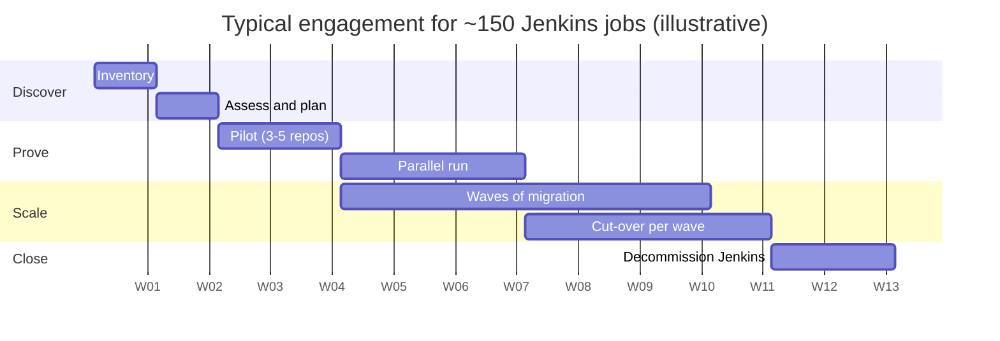

# Migration playbook: Jenkins to GitHub Actions

The playbook I follow for a Jenkins estate of 50 to 1,000 jobs. It is deliberately boring:
small pilots, measured parallel runs, a reversible cut-over and a decommission date that is
actually enforced.

## Phase 1 - Inventory (week 1)

**Goal:** know exactly what exists before promising anything.

- Export every job: type (freestyle, pipeline, multibranch, matrix), SCM, triggers, last
  successful run, average duration, agent labels, credentials used, plugins used.
- Run **GitHub Actions Importer** `audit` against the controller to get an automated
  conversion-readiness report (see [inventory/README.md](inventory/README.md)).
- Fill the [inventory template](inventory/jenkins-inventory-template.csv). Mark jobs with no
  successful run in 90 days as *retire candidates* - typically 20-30% of an estate.
- Record baseline metrics for the success criteria below (from the Jenkins API or build logs).

**Exit criteria:** every job has an owner, a complexity rating and a disposition
(migrate / retire / rewrite).

## Phase 2 - Assess and plan (week 2)

- Group jobs into **archetypes** (Node service, Java/Maven service, Terraform, scheduled
  maintenance, release jobs). Most estates have fewer than ten.
- For each archetype design the target: reusable workflow + composite actions + required
  checks. This repository is the archetype for "containerised service".
- Map every credential to its replacement (OIDC, `GITHUB_TOKEN`, environment secret, or
  delete). Cloud credentials must go to OIDC - no exceptions without a written risk acceptance.
- Decide runner strategy: GitHub-hosted by default; self-hosted (ARC on Kubernetes) only for
  network-restricted or specialised workloads.
- Plan **waves** of 10-30 jobs ordered by low risk / high value.

**Exit criteria:** signed-off target architecture, wave plan, RACI, risk register.

## Phase 3 - Pilot (weeks 3-4)

- Migrate 3-5 representative repositories, at least one per major archetype.
- Use `gh actions-importer dry-run` for a first draft, then hand-finish: pin actions by SHA,
  add least-privilege `permissions`, replace credentials with OIDC, move logic into reusable
  workflows.
- Publish the reusable workflows with semantic version tags.
- Developer feedback session; adjust templates.

**Exit criteria:** pilots green, developer feedback addressed, templates tagged `v1.0.0`.

## Phase 4 - Parallel run (weeks 5-7)

- Both pipelines run on every change for the wave. Jenkins stays the **source of truth**
  (it still deploys); GitHub Actions runs as a required-but-non-deploying check.
- Automated **parity check** compares outcomes on each run: same tests executed and passed,
  same image runtime config, same filesystem content, same SBOM package list. This repository
  implements it as the `parity` job ([ADR 0005](adr/0005-parity-check.md)).
- Track divergence in a shared dashboard; every divergence is either fixed or explained.

**Exit criteria:** 2 consecutive weeks (or 50 runs) with zero unexplained divergence per repo.

## Phase 5 - Cut-over (per wave)

1. Freeze pipeline changes in Jenkins for the wave (announce 1 week ahead).
2. Switch deploy responsibility: enable `deploy.yml` environments, disable the Jenkins deploy
   stages (keep build stages for one more week).
3. Make the GitHub Actions checks **required** in branch rulesets; remove the Jenkins status
   check.
4. Disable (do not delete) the Jenkins jobs. Keep config backups.

**Exit criteria:** first production deployment through GitHub Actions approved via environment
reviewers, monitored for 24 hours.

## Phase 6 - Decommission

- After 30 days with no rollback, archive job configs and build history needed for audit,
  then delete jobs.
- Revoke every credential in the Jenkins store (the most important security step of the
  project) and delete the service principals/users behind them.
- Shut down agents and the controller; cancel licences and VM reservations.
- Close-out report with before/after metrics.

## RACI

| Activity | Migration lead (me) | Platform team | Service teams | Security | Engineering manager |
| --- | --- | --- | --- | --- | --- |
| Inventory and audit | **R/A** | C | C | I | I |
| Target architecture and templates | **R** | **A** | C | C | I |
| Credential mapping to OIDC | **R** | C | I | **A** | I |
| Pilot migration | **R** | C | **A** (own repo) | I | I |
| Wave migrations | C | **R** | **A** | I | I |
| Parity sign-off | **R** | C | **A** | I | I |
| Cut-over go/no-go | C | R | C | C | **A** |
| Jenkins decommission | R | **A** | I | C | I |
| Credential revocation | C | R | I | **A** | I |

R = Responsible, A = Accountable, C = Consulted, I = Informed.

## Risk register

| # | Risk | Likelihood | Impact | Mitigation | Owner |
| --- | --- | --- | --- | --- | --- |
| 1 | Hidden behaviour in Jenkins plugins or shared library not reproduced | Medium | High | Parity job per repo; shared library walkthrough in Assess phase | Migration lead |
| 2 | Credential migration breaks deployments | Medium | High | OIDC federated credentials created and tested in Pilot; old credentials kept until Decommission | Security |
| 3 | Network access: runners cannot reach private systems | Medium | Medium | Inventory network dependencies; ARC self-hosted runners in the private network where required | Platform team |
| 4 | GitHub Actions minutes cost higher than expected | Low | Medium | Cost model per wave; caching; concurrency cancellation; larger runners only where they pay off | Engineering manager |
| 5 | Developer resistance / learning curve | Medium | Medium | Templates do the heavy lifting; office hours; concept-mapping cheat sheet | Platform team |
| 6 | Third-party action supply-chain compromise | Low | High | Pin by commit SHA, Dependabot with cooldown, allow-list of actions at org level | Security |
| 7 | Release freeze overlaps a wave | Medium | Low | Wave calendar agreed with release management | Engineering manager |
| 8 | Audit requirement for build history | Low | Medium | Export Jenkins build records before deletion; GitHub audit log streaming | Platform team |

## Rollback plan

Rollback is cheap because Jenkins is **disabled, not deleted**, until Decommission.

| Trigger | Action | Time to restore |
| --- | --- | --- |
| GitHub Actions outage blocking an urgent release | Re-enable the Jenkins job for that repository (config untouched), run it, disable again | < 15 minutes |
| Systematic defect in a reusable workflow | Consumers pinned to tags: revert the tag or ask consumers to pin the previous version | < 30 minutes |
| Production deployment fails | `deploy.yml` performs `kubectl rollout undo` automatically on failure; manual re-deploy of the previous digest via `workflow_dispatch` | < 10 minutes |
| Wave shows unexplained parity divergence after cut-over | Move wave back to Jenkins-as-source-of-truth, keep GitHub Actions as a check, re-enter Parallel run | 1 hour |

## Success metrics

Measured for the baseline in Inventory and again 30 days after cut-over.

| Metric | Definition | Source | Typical target |
| --- | --- | --- | --- |
| Lead time for changes | Merge to production deployment | Deployment events (GitHub Deployments API / Jenkins build timestamps) | -50% |
| Build duration (p50/p95) | Pipeline wall-clock time per commit | Workflow run durations | -30 to -60% with caching |
| Queue time | Time waiting for an executor/runner | Jenkins queue API vs. job `started_at - created_at` | Near zero on hosted runners |
| Cost per build | Runner minutes x rate + amortised controller/agent cost | Billing exports | Lower or equal, with ops time removed |
| MTTR for pipeline failures | Failure to green | Run history | -50% |
| Change failure rate | Deployments causing rollback | Deployment history | Equal or better |
| Stored long-lived credentials | Count of cloud/registry secrets in CI | Credential inventory | **Zero** |
| Platform toil | Hours/month on controller, plugin and agent maintenance | Team time tracking | -80% or better |

The numbers for this demo are in [metrics.md](metrics.md) and are clearly labelled as
illustrative.
